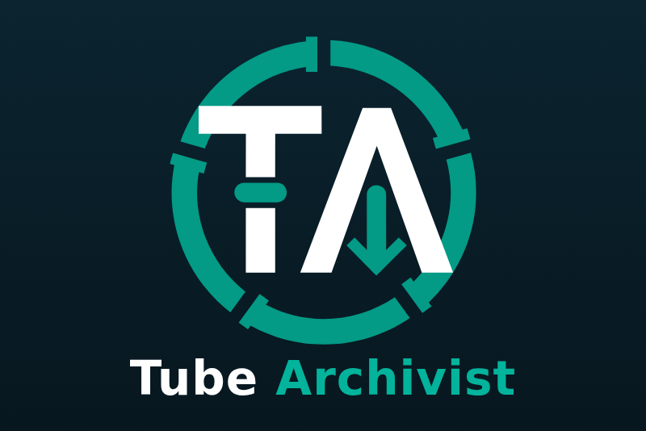

# Tube Archivist for Gladys Assistant

An external integration for [Gladys Assistant](https://gladysassistant.com) that
brings a [Tube Archivist](https://www.tubearchivist.com) server (the self-hosted
archive of YouTube channels, based on yt-dlp) into Gladys, over the local
network.



## What it does

- **One device**: online, archived videos, subscribed channels, library size
  (GB), videos in the queue, failed downloads, videos downloaded today, the task
  in progress and the last video archived (title and channel, as text).
- **Scene triggers**: a new video was archived (channel, title, publication
  date, duration, link to its page in Tube Archivist), a download failed (with
  the yt-dlp error), the queue was emptied. The first two can be filtered on a
  channel.
- **Scene actions**: read the latest videos (a sentence for a message or a voice
  announcement, with the figures separately), rescan the subscriptions, add a
  YouTube link (video, playlist, channel) to the queue, downloaded at once or in
  turn.
- **Dashboard widget**: downloaded today, in the queue, failed, the task in
  progress, the latest videos archived, and two buttons: “Add a video” (a form)
  and “Rescan”.

The user documentation, in English, French, German and Spanish, is in
[`docs/`](docs/en.md) and is shown by Gladys.

Tested against a real Tube Archivist v0.5.12 (the official Docker images, with
real downloads from YouTube), not yet in a real Gladys installation: feedback
welcome on the [Gladys forum](https://community.gladysassistant.com) or in the
[issues](https://github.com/guim31/gladys-tubearchivist/issues).

## Requirements

- Gladys Assistant 5.2.0 or later (the form of the widget button).
- A Tube Archivist server v0.5 or later reachable from Gladys, on the port of
  its web interface (`8000` by default).
- The API token of an admin user (**Settings → Application** in Tube
  Archivist): the queue and the tasks are reserved to admins.

## Installation

In Gladys: **Integrations** → **Install from GitHub**, with the address of this
repository: `https://github.com/guim31/gladys-tubearchivist`. Then enter the
address of Tube Archivist and its API token in the configuration, and add the
device from the **Discover** tab.

## How it works

The integration calls the REST API of Tube Archivist (`Authorization: Token …`)
at the chosen interval (2 minutes by default), eight small GETs: `/api/ping/`,
`/api/stats/video/`, `/api/stats/channel/`, `/api/stats/download/`,
`/api/stats/downloadhist/`, `/api/video/?sort=downloaded&order=desc` (the 25
latest downloads), `/api/download/?filter=pending&error=true` (the failed
downloads) and `/api/notification/` (the running tasks). The commands use
`POST /api/download/` (with `autostart` for “at once”, then
`/api/task/by-id/<id>/` to report a refused link) and
`POST /api/task/by-name/update_subscribed/`.

The ids of the videos already seen are kept under `/data`: an event is announced
once, even after a restart, and what Tube Archivist had before is never
announced. Only the changes are sent to Gladys. Apprise notifications of Tube
Archivist are not used: they would need an inbound port, which the sandbox of
Gladys does not open.

## Limits

- One Tube Archivist server per integration.
- Events are as fresh as the refresh interval; at most 10 events of each kind
  per refresh.
- A video imported or rescanned with an old download date is not announced.
- Written for the API of Tube Archivist v0.5 (tested on v0.5.12); older versions
  had other paths.

## Development

```bash
npm ci
npm run format:check && npm run lint && npm test
npx -y github:GladysAssistant/integration-store --skip-image-check .
```

The tests run against the fake Gladys of the SDK and an in-memory Tube Archivist
that answers with the shape of the real API (`test/fixtures/tubearchivist/`,
recorded from Tube Archivist v0.5.12). See [`CLAUDE.md`](CLAUDE.md) for the
architecture and the pitfalls.

## Credits

- [Tube Archivist](https://github.com/tubearchivist/tubearchivist) by
  bbilly1 and its contributors (GPL-3.0). The logo of the cover comes from its
  official repository
  ([`assets/tube-archivist-logo-dark.svg`](https://github.com/tubearchivist/tubearchivist/tree/master/assets)).
  No code of Tube Archivist is copied: the integration only calls its API.
- Built on the official
  [integration template](https://github.com/GladysAssistant/integration-template-js)
  and SDK of Gladys Assistant; structure adapted from
  [gladys-pinchflat](https://github.com/guim31/gladys-pinchflat).

Not affiliated with Tube Archivist, YouTube or Google. Licensed under the
[Apache License 2.0](LICENSE).
